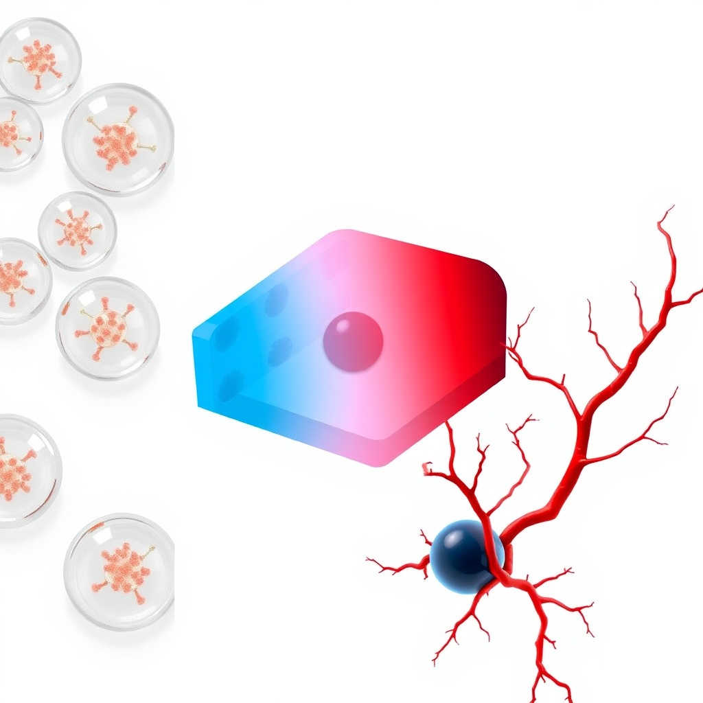

<a id="readme-top"></a>
<!-- best-readme-template -->
<div align="center">

<h1 align="center">T1D Digital Twin & Hypoimmune Organoid Simulator</h1>

<p align="center">
  Open-source, literature-calibrated multiphysics digital twin for Type 1 Diabetes islet encapsulation and hypoimmune organoid transplant design.
  <br />
  <br />
  <a href="https://github.com/Bezooom/t1d-simulator/tree/HEAD/docs"><strong>Docs »</strong></a> · <a href="https://github.com/Bezooom/t1d-simulator/issues/new?labels=bug">Report Bug</a> · <a href="https://github.com/Bezooom/t1d-simulator/issues/new?labels=enhancement">Request Feature</a> · <a href="README.ru.md">Русский</a>
</p>

<p align="center">
  <a href="https://github.com/Bezooom/t1d-simulator/actions/workflows/ci.yml"></a>
  <a href="https://github.com/Bezooom/t1d-simulator/releases/latest"></a>
  <a href="https://github.com/Bezooom/t1d-simulator/blob/HEAD/LICENSE"></a>
  <a href="https://github.com/Bezooom/t1d-simulator/stargazers"></a>
  <a href="https://github.com/Bezooom/t1d-simulator/commits"></a>
  <a href="https://github.com/Bezooom/t1d-simulator/issues"></a>
</p>

</div>

<details open>
<summary><b>📑 Table of Contents</b></summary>

- [📖 About The Project](#-about-the-project)
- [🔮 Core Features](#-core-features)
- [📂 Repository Structure](#-repository-structure)
- [🧱 Built With](#-built-with)
- [🚀 Quickstart](#-quickstart)
- [Documentation](#documentation)
- [📊 Scientific Validation](#-scientific-validation)
- [📑 Citation & Academic Use](#-citation--academic-use)
- [🗺️ Roadmap](#-roadmap)
- [🤝 Contributing](#-contributing)
- [📄 License](#-license)
- [📬 Contact](#-contact)
- [🙏 Acknowledgments](#-acknowledgments)

</details>

## 📖 About The Project

**Language / Язык:** **English** · [Русский](README.ru.md)

[](https://github.com/Bezooom/t1d-simulator/actions/workflows/ci.yml)
[](https://opensource.org/licenses/MIT)
[](docs/manuscript_biorxiv_en.md)
[](docs/manuscript_biorxiv_ru.md)
[](https://github.com/Bezooom/t1d-simulator/releases/tag/v1.1.0)
[](zenodo.json)

Open-source, literature-calibrated engine (`t1d_simulator`) by **Pavel V. Naumov**. It maps which **implant geometries** for encapsulated $\beta$-cells are physically allowed by oxygen transport — and which are not — before wet-lab work.

**Main result:** a checked Krogh length $L^*$. Thick subcutaneous slabs ($\ge 250\ \mu\mathrm{m}$ half-thickness at $\ge 50$ M/ml) and $400\ \mu\mathrm{m}$ capsules at typical density sit *above* $L^*$. A thin omental sheet or small spheres do not. Edmonton-like cell mass is an **area** problem (~650 cm²), not a thicker pancake. Not a clinical product.



---

## 🔮 Core Features

*   **Oxygen Transport PDE Solver:** Solves the non-linear reaction-diffusion equations under spherical, cylindrical, and planar geometries to identify diffusion barriers and necrotic core formation ($pO_2 < 0.5\ \mathrm{mmHg}$).
*   **Physics-Informed Neural Network (PINN):** A mesh-free neural solver surrogate that computes steady-state oxygen concentration profiles in under 10 milliseconds, enabling real-time parameter sweeps.
*   **IBMIR Coagulation ODE Cascade:** A compartmental model of the 0–48h Instant Blood-Mediated Inflammatory Reaction (*Tissue Factor → Thrombin → Fibrin Clot*) which dynamically reduces oxygen permeability at the boundary.
*   **GNN Anti-Fibrotic Screening:** A Graph Neural Network that maps chemically modified alginate monomers (SMILES) to foreign body reaction (FBR) fibrotic capsule thickness ($L_{\mathrm{fib}}$) predictions.
*   **Clinical Dose Calculator:** Translates virtual patient mass and daily insulin requirements (TDI) into target islet equivalents (IEQ), organoid counts, and omental scaffold volume.
*   **Bergman OGTT Glycemic Dynamics:** Simulates glucose-stimulated insulin secretion (GSIS) and glucose clearance curves during oral glucose tolerance tests (OGTT).
*   **CGM 30-Day Monitoring:** Simulates long-term continuous glucose metrics, returning GMI (HbA1c), Time-in-Range (TIR), Time-Below-Range (TBR), and Time-Above-Range (TAR).
*   **CAD/STL Scaffold Exporter:** Procedurally generates and exports 3D porous TPMS scaffolds (STL format) matching patient-specific omental pouch area requirements.

---

## 📂 Repository Structure

```
.
├── .github/workflows/          # CI/CD pipelines
├── data/
│   ├── literature_params.yaml  # Curated parameters with literature citations
│   └── benchmarks.py           # Verification script for validation datasets
├── docs/
│   ├── figures/                # Manuscripts schematics and graphical abstract
│   ├── manuscript_biorxiv_en.md  # Preprint v1.3 (English)
│   ├── manuscript_biorxiv_ru.md  # Preprint v1.3 (Russian)
│   └── endocrinologist_brief_ru.md
│   ├── site_comparison_matrix.md# Comparative matrix of transplant locations
│   └── *.md                    # Clinical passports, MoU templates, protocols
├── reports/
│   ├── benchmarks/             # Predicted vs reported validation
│   └── sweeps/                 # screen_design --sweep CSV/JSON/heatmaps
├── archive/                    # Historical notes (not the public product)
├── scripts/                    # Helper scripts for screening and email templates
├── t1d_simulator/              # Python simulator source package
│   ├── app.py                  # Main Streamlit dashboard (monolith)
│   ├── ibmir_module.py         # IBMIR kinetics solver
│   ├── verify_model.py         # Integration tests (44)
│   └── parameters.yaml         # Default runtime parameters
└── pyproject.toml              # Build configurations and dependency lists
```

---

## 🧱 Built With

<p>


</p>

## 🚀 Quickstart

### 1. Installation
The package runs on Python 3.9–3.12. Clone the repository and install dependencies:

```bash
git clone https://github.com/Bezooom/t1d-simulator.git
cd t1d-simulator
pip install -r t1d_simulator/requirements.txt
```

### 2. Run Interactive Dashboard
Launch the Streamlit graphical user interface:

```bash
streamlit run t1d_simulator/app.py
```

### 3. Verify Model and Run Tests
Run the 44-test integration test suite on CPU:

```bash
export CUDA_VISIBLE_DEVICES=""
python3 t1d_simulator/verify_model.py
```

### 4. Execute Construct Screening
Single design:

```bash
python3 t1d_simulator/screen_design.py --geometry spherical --radius 200 --density 80 --site omental_pouch
```

Density × thickness sweep + heatmap (the design-space product):

```bash
python3 t1d_simulator/screen_design.py --sweep \
  --geometry planar --site subcutaneous --no-heparin \
  --densities 20,50,80,100 --radii 100,150,200,250 \
  --export-csv reports/sweeps/planar_sq.csv \
  --export-json reports/sweeps/planar_sq.json \
  --heatmap reports/sweeps/heatmap_viability_planar_sq.png \
  --heatmap-po2 reports/sweeps/heatmap_po2_planar_sq.png
```

### 5. Verified design bounds (analytical Krogh vs BVP)

```bash
CUDA_VISIBLE_DEVICES="" python3 t1d_simulator/design_bounds.py
```

Report: [`reports/design_bounds/verified_design_space.md`](reports/design_bounds/verified_design_space.md).

Dose vs Krogh (Edmonton mass → surgical area): `python3 t1d_simulator/dose_transport.py` → [`reports/dose_transport/dose_vs_krogh.md`](reports/dose_transport/dose_vs_krogh.md).

Islet scale + death window + literature sizes: `python3 t1d_simulator/scaleup_science.py` → [`reports/scaleup/remaining_biotech_bounds.md`](reports/scaleup/remaining_biotech_bounds.md).

---

## Documentation

| | English | Русский |
|--|---------|---------|
| This README | [README.md](README.md) | [README.ru.md](README.ru.md) |
| Preprint | [manuscript_biorxiv_en.md](docs/manuscript_biorxiv_en.md) | [manuscript_biorxiv_ru.md](docs/manuscript_biorxiv_ru.md) |
| One page for clinicians | — | [endocrinologist_brief_ru.md](docs/endocrinologist_brief_ru.md) |
| Geometry bound $L^*$ | [verified_design_space.md](reports/design_bounds/verified_design_space.md) | same numbers |
| Dose → area | [dose_vs_krogh.md](reports/dose_transport/dose_vs_krogh.md) | same |
| Islet size + death window | [remaining_biotech_bounds.md](reports/scaleup/remaining_biotech_bounds.md) | same |
| Who to write (RU-first) | — | [outreach_playbook.md](docs/outreach_playbook.md) |
| Docs index | [docs/README.md](docs/README.md) | [docs/README.md](docs/README.md) |

---

## 📊 Scientific Validation

The digital twin's transport and cell survival solvers have been benchmarked and validated against independent published datasets:

| Benchmark | Reference Paper | Target Metric | Agreement Status |
|-----------|-----------------|---------------|------------------|
| **Krogh Limit** | Secomb et al. (2004) | Viability boundary limit (~200 $\mu\text{m}$) | **PASS** (1.00 ratio) |
| **Spherical Alginate** | Papas et al. (2007) | Viability sweep ($R = 400\ \mu\text{m}$) | **PASS** (RMSE = 10.42%) |
| **Planar Macrodevice** | Papabathini et al. (2023) | Hypoxic core profile ($L = 250\ \mu\text{m}$) | **PASS** (RMSE = 11.42%) |
| **IBMIR Time-Course** | Hackett et al. (2013) | 48h acute cell retention | **PASS** (1.03 ratio) |
| **Angiogenesis** | Berney et al. (2016) | Capillary perfusion time | **PASS** (0.80 ratio) |

---

## 📑 Citation & Academic Use

If you use this simulator or reference the preprint findings in your research, please cite the work as follows:

```bibtex
@article{naumov2026multiphysics,
  title={Multiphysics Failure Modes of \beta-Cell Encapsulation: From the Krogh Diffusion Limit to Hypoimmune Organoid Digital Twins},
  author={Naumov, Pavel V.},
  journal={bioRxiv},
  year={2026},
  doi={To be assigned},
  url={https://github.com/Bezooom/t1d-simulator}
}
```

---

## 🗺️ Roadmap

Detailed plan: [ROADMAP.md](ROADMAP.md). See the [open issues](https://github.com/Bezooom/t1d-simulator/issues) for the full list of ideas and known problems.

## 🤝 Contributing

Contributions are welcome. If you have an idea that would make this better, open an issue or a pull request:

1. Fork the repository
2. Create a branch (`git checkout -b feature/my-idea`)
3. Commit (`git commit -m 'feat: my idea'`)
4. Push (`git push origin feature/my-idea`)
5. Open a pull request

## 📄 License
This project is licensed under the **MIT License** — see the `LICENSE` file for details. Open for academic and commercial co-development. For research collaborations and custom in silico design sweeps, please contact `naumov122@gmail.com`.

## 📬 Contact

**Pavel Naumov** (Bezooom) — [naumovai.ru](https://naumovai.ru) · [X @Bezooooom](https://x.com/Bezooooom) · naumov122@gmail.com

Project: [https://github.com/Bezooom/t1d-simulator](https://github.com/Bezooom/t1d-simulator)

## 🙏 Acknowledgments

- Published physiological parameters cited in [docs](docs) and the preprint
- [Zenodo](https://zenodo.org) metadata (`zenodo.json`)
- [Best-README-Template](https://github.com/othneildrew/Best-README-Template)
- [Shields.io](https://shields.io)

<p align="right">(<a href="#readme-top">back to top</a>)</p>
