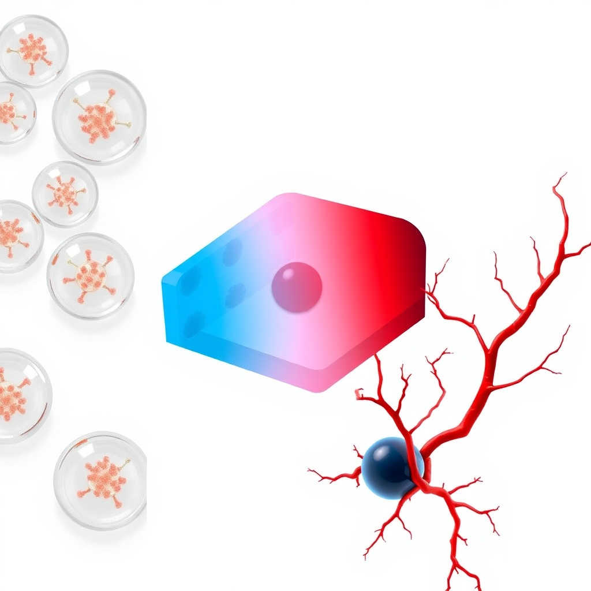

# Цифровой двойник СД1 и гипоиммунных органоидов

**Язык / Language:** [English](README.md) · **Русский**

[](https://github.com/Bezooom/t1d-simulator/actions/workflows/ci.yml)
[](https://opensource.org/licenses/MIT)
[](docs/manuscript_biorxiv_ru.md)
[](docs/manuscript_biorxiv_en.md)

Открытый расчёт **Павла Наумова**: какой формы и толщины можно сажать инкапсулированные $\beta$-клетки при СД1, а какой — нельзя (кислород не доходит до середины). Это не лекарство и не протокол пересадки.

**Главный результат:** граница Крога $L^*$. Толстый подкожный лист ($\ge 250$ мкм полутолщины при $\ge 50$ млн/мл) и капсулы радиусом $400$ мкм на типичной плотности — **выше** $L^*$. Тонкий лист у сальника или мелкие сферы — нет. Доза уровня Эдмонтона — это **площадь** (~650 см², с лист A4), не «ещё потолще».



---

## Для эндокринолога (одна страница)

[Пояснение простыми словами](docs/endocrinologist_brief_ru.md) · [статья RU](docs/manuscript_biorxiv_ru.md) · [статья EN](docs/manuscript_biorxiv_en.md)

---

## Что умеет код

- **Кислород (PDE)** — пластина / цилиндр / сфера, кинетика Михаэлиса–Ментен, фиброз, АФК.
- **Граница $L^*$** — аналитика + сверка с численным решателем (`design_bounds.py`).
- **Доза → площадь** — сколько см² сальника на 70 кг (`dose_transport.py`).
- **Островок и окно до сосудов** — ядро нативного IEQ, мышь 8 сут. vs человек 18 сут. (`scaleup_science.py`).
- **Скрининг** — `screen_design` (один дизайн или `--sweep` + heatmap).
- **IBMIR 0–48 ч** — TF → тромбин → сгусток, гепарин.
- **PINN / GNN / UI** — ускорение, разведочный скрининг полимеров, Streamlit. Не главный claim.

---

## Быстрый старт

```bash
git clone https://github.com/Bezooom/t1d-simulator.git
cd t1d-simulator
pip install -r t1d_simulator/requirements.txt

export CUDA_VISIBLE_DEVICES=""
python3 t1d_simulator/verify_model.py          # 44 теста
streamlit run t1d_simulator/app.py

# один дизайн
python3 t1d_simulator/screen_design.py --geometry spherical --radius 200 --density 80 --site omental_pouch

# сетка + картинка
python3 t1d_simulator/screen_design.py --sweep \
  --geometry planar --site subcutaneous --no-heparin \
  --densities 20,50,80,100 --radii 100,150,200,250 \
  --heatmap reports/sweeps/heatmap_viability_planar_sq.png

# проверенные границы
python3 t1d_simulator/design_bounds.py
python3 t1d_simulator/dose_transport.py
python3 t1d_simulator/scaleup_science.py
```

---

## Документация

| Документ | Русский | English |
|----------|---------|---------|
| Этот README | [README.ru.md](README.ru.md) | [README.md](README.md) |
| Препринт v1.3 | [manuscript_biorxiv_ru.md](docs/manuscript_biorxiv_ru.md) | [manuscript_biorxiv_en.md](docs/manuscript_biorxiv_en.md) |
| Для клинициста | [endocrinologist_brief_ru.md](docs/endocrinologist_brief_ru.md) | — |
| Граница $L^*$ | [verified_design_space.md](reports/design_bounds/verified_design_space.md) | то же |
| Доза → площадь | [dose_vs_krogh.md](reports/dose_transport/dose_vs_krogh.md) | то же |
| Островок + сосуды | [remaining_biotech_bounds.md](reports/scaleup/remaining_biotech_bounds.md) | то же |
| Кому писать | [outreach_playbook.md](docs/outreach_playbook.md) | — |
| Оглавление docs | [docs/README.md](docs/README.md) | [docs/README.md](docs/README.md) |

---

## Проверка на чужих данных

| Бенчмарк | Статья | Итог |
|----------|--------|------|
| Предел Крога | Secomb et al., 2004 | PASS |
| Сферы альгината | Papas et al., 2007 | RMSE **10.42%** |
| Планарный макродевайс | Papabathini et al., 2023 | RMSE **11.42%** |

---

## Цитирование

```bibtex
@software{t1d_digital_twin_2026,
  title = {T1D Digital Twin \& Hypoimmune Organoid Simulator},
  author = {Naumov, Pavel V.},
  year = {2026},
  url = {https://github.com/Bezooom/t1d-simulator},
  version = {1.0.0},
  license = {MIT}
}
```

## Лицензия

MIT — файл [LICENSE](LICENSE). Вопросы: `naumov122@gmail.com`.
