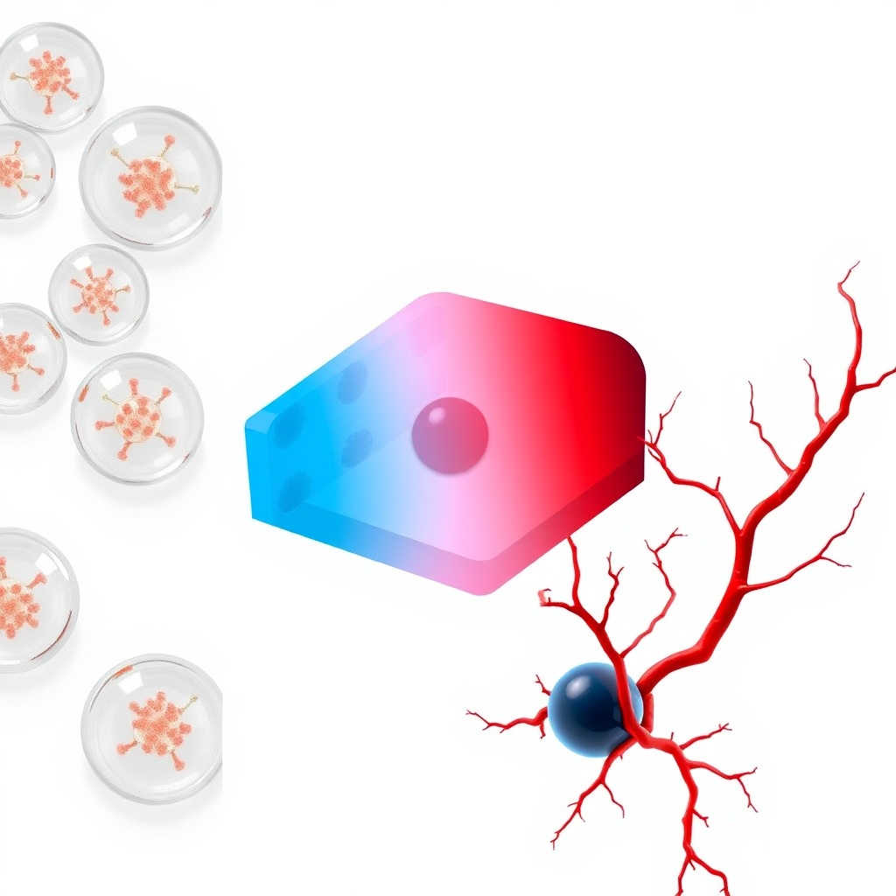
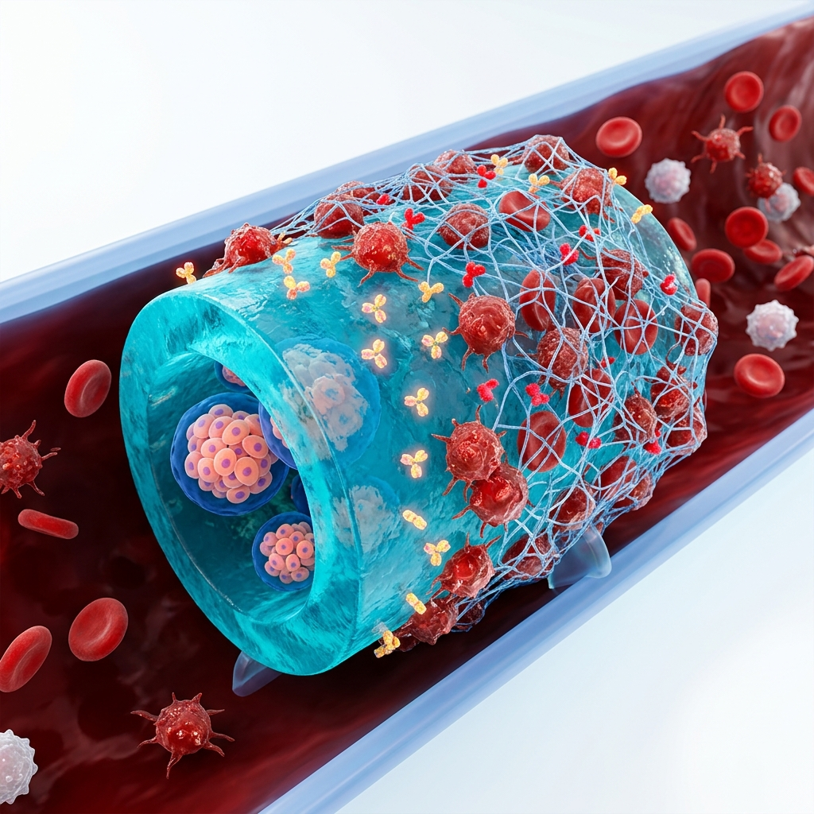
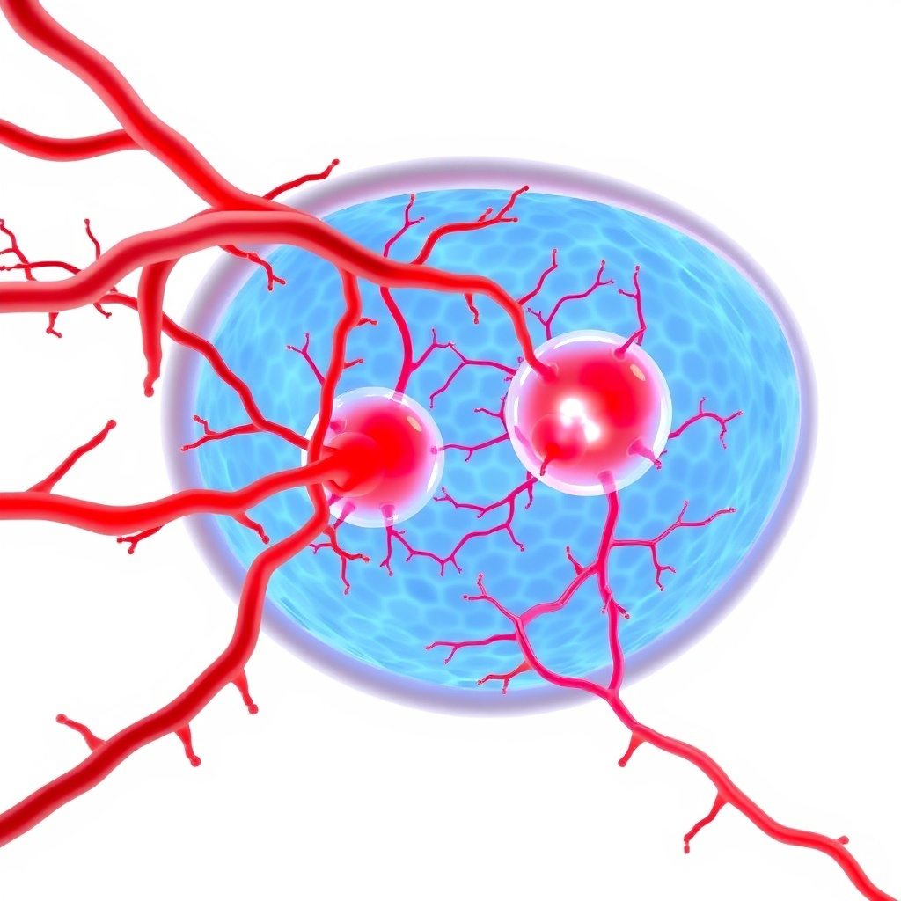

# Multiphysics Failure Modes of $\beta$-Cell Encapsulation: From the Krogh Diffusion Limit to Hypoimmune Organoid Digital Twins

**Author:** Pavel V. Naumov  
**Correspondence:** `naumov122@gmail.com`  
**Target venue:** bioRxiv (Category: Synthetic Biology / Bioengineering)  
**Date:** August 2026  
**Document status:** Preprint manuscript **v1.3** (GitHub: https://github.com/Bezooom/t1d-simulator ; Zenodo DOI pending)  
**Software:** `t1d_simulator` v1.0.0 (MIT License)  

---

## Abstract

Cell replacement therapy using stem cell-derived pancreatic $\beta$-cells offers a potentially curative approach for Type 1 Diabetes (T1D). However, the clinical utility of macro- and microencapsulated cell grafts is restricted by cellular necrosis under physiological conditions, active foreign body responses, and acute inflammatory reactions. In this study, we present an open-source, calibrated multiphysics digital twin engine (`t1d_simulator` v1.0.0) designed to systematically evaluate these failure modes in silico. By integrating non-linear reaction-diffusion partial differential equations (PDEs), Physics-Informed Neural Networks (PINNs), Graph Neural Networks (GNNs) for anti-fibrotic chemical screening, and discrete population dynamics, the platform models oxygen transport, fibrotic capsule formation, reactive oxygen species (ROS) toxicity, and the acute 0–48h Instant Blood-Mediated Inflammatory Reaction (IBMIR). The model was validated against independent islet viability datasets, achieving low root-mean-square error values of 10.42% and 11.42% across spherical and planar geometries. Parameter sensitivity analysis identified effective diffusivity, metabolic consumption ($V_{\max}$), and boundary oxygen tension as the dominant viability drivers. A sufficient Krogh bound $L^*$ was derived and checked against the numerical BVP (mean $L_{\mathrm{num}}/L^*=1.08$; no certificate violations). Planar subcutaneous half-thickness $\ge 250\ \mu\mathrm{m}$ at $\ge 50$ M/ml and $400\ \mu\mathrm{m}$ capsules at $50$ M/ml lie above $L^*$ and match published viability losses. A native $150\ \mu\mathrm{m}$ IEQ already has an $\sim 38\%$ anoxic core in SQ $pO_2$. Edmonton-like cell mass maps to $\sim 650\ \mathrm{cm}^2$ of a thin omental sheet, not a thicker slab. During an $18$-day human avascular wait a thick SQ device retains $\sim 14\%$ of mass. These geometry rules — not a clinical product — are the main result.

---

## 1. Introduction

Type 1 Diabetes (T1D) is an autoimmune condition characterized by the selective destruction of insulin-producing pancreatic $\beta$-cells. Standard treatments, including intensive insulin administration and continuous glucose monitoring, have improved patient outcomes but do not prevent long-term microvascular and cardiovascular complications. Allogeneic islet transplantation can establish insulin independence, yet its widespread application is limited by the scarcity of donor organs and the necessity of lifelong systemic immunosuppression, which carries significant risks of toxicity, infection, and malignancy.

To address these limitations, researchers have developed methods to differentiate human pluripotent stem cells (hPSCs) into functional, glucose-responsive $\beta$-cells. Concurrently, various macro- and microencapsulation strategies have been investigated to physically isolate the transplanted cells from the host immune system. Encapsulating grafts in semi-permeable hydrogels, such as alginate, permits the diffusion of glucose, insulin, and essential nutrients while blocking host immune cells and large immunoglobulins.

Despite promising results in small animal models, clinical trials of encapsulated cell therapies have frequently failed. These failures are primarily driven by three understudied physiological bottlenecks. First, the absence of an internal capillary network forces the encapsulated cells to rely entirely on passive diffusion for oxygen and nutrient transport. Consequently, large diffusion distances limit oxygen availability, leading to central core necrosis and a loss of glucose-stimulated insulin secretion (GSIS). This transport limitation is historically framed by the Krogh cylinder model, which defines the maximum distance oxygen can travel through metabolizing tissue before depletion.

Second, the implantation of biomaterials triggers a foreign body reaction (FBR). Host macrophages and foreign body giant cells adhere to the hydrogel surface, initiating a cascade that recruits fibroblasts and deposits a dense collagenous fibrotic capsule. This capsule acts as an additional transport barrier, increasing the effective diffusion path length ($L_{\mathrm{fib}}$) and further starving the encapsulated cells. Third, the infusion of cells into vascularized environments, such as the portal vein, triggers an instant blood-mediated inflammatory reaction (IBMIR). Exposure of tissue factor (TF, CD142) on the graft surface initiates the coagulation cascade, generating thrombin, recruiting platelets, and forming a fibrin clot that isolates the cells and leads to acute cell death within 48 hours.

Given the complexity of these transport and immunological dynamics, empirical optimization through in vivo animal studies is slow and resource-intensive. Computational modeling offers a systematic way to map the multiphysics design space and return negative predictions—identifying which loadings, thicknesses, and sites are physically implausible before wet-lab commitment. In this study, we present a calibrated digital twin of the T1D cell transplant microenvironment. The platform integrates partial differential equations for oxygen reaction-diffusion, surrogate neural solvers, Graph Neural Networks for material selection, and discrete kinetic models of the early coagulation cascade. Using this framework, we analyze the physical limits of standard encapsulation and evaluate bioengineering strategies to improve graft survival.

---

## 2. Mathematical & Physical Methods

### 2.1. Oxygen Transport & Consumption PDE
Oxygen transport and metabolic consumption within the hydrogel and surrounding tissue are modeled using a non-linear reaction-diffusion partial differential equation. Under transient conditions, the governing equation is:

$$\frac{\partial C}{\partial t} = D_{\mathrm{eff}} \nabla^2 C - R_{\mathrm{cells}}(C) - R_{\mathrm{macs}}(C) + S_{\mathrm{ogm}}(t)$$

where $C(r, t)$ represents the local oxygen concentration, and $D_{\mathrm{eff}}$ is the effective diffusion coefficient of oxygen within the specific hydrogel matrix. Metabolic oxygen consumption by the encapsulated $\beta$-cells ($R_{\mathrm{cells}}$) and infiltrating host macrophages ($R_{\mathrm{macs}}$) follows Michaelis-Menten kinetics:

$$R_{\mathrm{cells}}(C) = \frac{V_{\max} C}{K_M + C} \cdot \rho_{cell} \cdot f_{viab}$$

Here, $V_{\max}$ is the maximum oxygen consumption rate of human $\beta$-cells, calibrated in this study to $1.5 \times 10^{-16}\ \text{mol}/(\text{cell} \cdot \text{s})$ based on literature measurements (Buchwald et al., 2011). $K_M$ is the Michaelis constant, set to $0.5\ \text{mmHg}$ (Dionne et al., 1993), $\rho_{cell}$ is the local cell seeding density, and $f_{viab}$ represents the local viable cell fraction. The term $S_{\mathrm{ogm}}(t)$ accounts for active oxygen generation systems, such as calcium peroxide core-shell formulations. The spatial domain is discretized into planar slabs, solid cylinders, or spheres, applying Dirichlet boundary conditions at the capsule-tissue interface ($C = pO_2^{boundary}$) and zero-flux Neumann boundary conditions at the geometric center ($\nabla C \cdot \mathbf{n} = 0$).

### 2.2. Physics-Informed Neural Network (PINN) Solver
To accelerate spatial parameter sweeps within the user interface, we implemented a mesh-free Physics-Informed Neural Network (PINN) as a surrogate solver for the steady-state reaction-diffusion equation. The neural network, parameterized by weights and biases $\theta$, maps spatial coordinates $x$ to oxygen concentrations $\hat{C}(x; \theta)$. The network is trained by minimizing a composite loss function:

$$\mathcal{L}_{total}(\theta) = \mathcal{L}_{\mathrm{PDE}}(\theta) + \lambda_{BC} \mathcal{L}_{BC}(\theta)$$

where the PDE residual loss is evaluated over a set of collocation points $X_c$:

$$\mathcal{L}_{\mathrm{PDE}}(\theta) = \frac{1}{|X_c|} \sum_{x \in X_c} \left| D_{\mathrm{eff}} \frac{d^2 \hat{C}(x;\theta)}{dx^2} - \frac{V_{\max} \hat{C}(x;\theta)}{K_M + \hat{C}(x;\theta)} \rho_{cell} \right|^2$$

The boundary loss $\mathcal{L}_{BC}$ enforces the Dirichlet boundary conditions at the edges of the domain. By utilizing automatic differentiation to compute the spatial derivatives, the trained PINN acts as a fast solver, generating spatial oxygen profiles across various capsule thicknesses and cell densities in less than 10 milliseconds.

### 2.3. IBMIR Coagulation ODE Cascade
The acute 0–48h Instant Blood-Mediated Inflammatory Reaction (IBMIR) is modeled as a compartmental system of ordinary differential equations (ODEs). The cascade begins with the exposure of tissue factor (TF, CD142) on the cell or scaffold surface, which triggers thrombin generation and subsequent fibrin clot formation:

$$\frac{d[\text{TF}]}{dt} = -k_{\mathrm{deg}}^{\mathrm{TF}} [\text{TF}]$$

$$\frac{d[\text{Thrombin}]}{dt} = k_{gen} [\text{TF}] - k_{inh}(\text{Heparin}) [\text{Thrombin}]$$

$$\frac{d[\text{Clot}]}{dt} = k_{clot} [\text{Thrombin}] \left( 1 - \frac{[\text{Clot}]}{L_{\mathrm{clot}}^{\max}} \right)$$

where $[\text{TF}]$ represents the active surface tissue factor concentration, which decays as platelets cover the graft. Thrombin generation rate ($k_{gen}$) drives the production of active thrombin, which is inhibited by local heparinization ($k_{inh}$). The clot thickness grows in proportion to thrombin concentration up to a maximum limit ($L_{\mathrm{clot}}^{\max}$).

The accumulation of the fibrin clot restricts local oxygen transport by reducing the effective permeability at the boundary:

$$D_{\mathrm{eff}}^{boundary} = D_{\mathrm{base}} \cdot \left( 1 - \alpha \frac{[\text{Clot}]}{L_{\mathrm{clot}}^{\max}} \right)$$

where $\alpha$ represents the permeability reduction factor (calibrated to $0.6$ for standard fibrin clots). The resulting decrease in oxygen transport leads to cell death when local $pO_2$ falls below the critical threshold for viability ($0.5\ \text{mmHg}$).

### 2.4. Design-space screening API (`screen_design`)
Constructs are evaluated via a single entry point (`screen_design`) that couples site-specific boundary $pO_2$, geometry, cell density, optional fibrosis thickness, and heparin coating. The module calculates the spatially integrated viable cell fraction, minimum core $pO_2$, and 48-hour cell retention. It then automatically assigns status badges (PASS / WARNING / FAIL) based on physiological thresholds. The default failure rules are defined as: core anoxia if $\min pO_2 < 0.5\ \text{mmHg}$, severe hypoxia if $< 5\ \text{mmHg}$, IBMIR risk if retention $< 85\%$, and viability failure if viable fraction $< 70\%$.

### 2.5. Parameter Sensitivity and Tornado Analysis
To identify which physical parameters dominate graft survival, we conducted a local sensitivity analysis. We applied one-at-a-time $\pm 20\%$ perturbations to $V_{\max}$, $K_M$, $D_{\mathrm{eff}}$, boundary $pO_2$, and $L_{\mathrm{fib}}$ using a baseline planar construct configuration ($R = 200\ \mu\text{m}$, $80 \times 10^6\ \text{cells/mL}$, omental boundary $pO_2$). The parameters were ranked based on the absolute change in the resulting viable cell fraction.

---

## 3. Results & Discussion

### 3.1. Literature Benchmark Validation
To confirm the physical accuracy of the model, we compared the simulated values against published experimental data. The steady-state oxygen transport solver was validated using data from Papas et al. (2007) for spherical alginate microcapsules ($R = 400\ \mu\text{m}$) containing pancreatic islets. Under varying bulk oxygen tensions, the predicted viable cell fractions closely matched the reported experimental measurements, achieving a root-mean-square error ($RMSE$) of 10.42%. 

We also benchmarked the model against data from Papabathini et al. (2023) for a planar macroencapsulation device ($L = 250\ \mu\text{m}$ half-thickness) under subcutaneous oxygen conditions ($30\ \text{mmHg}$). The predicted oxygen profile, which showed a hypoxic core ($pO_2 < 1\ \text{mmHg}$) extending through the central $80\ \mu\text{m}$ of the slab, aligned with the reported experimental cell viability distribution ($RMSE = 11.42\%$). These results suggest that the mathematical formulations reasonably capture the transport and metabolic dynamics of encapsulated islet tissues.

### 3.2. Quantitative Failure Analysis of Encapsulation Geometries
Using the validated model, we performed a systematic parameter sweep to identify the limits of cell survival across different encapsulation geometries. Planar hydrogel slabs, cylindrical fibers, and spherical microcapsules were simulated under subcutaneous oxygen conditions ($pO_2 = 30\ \text{mmHg}$) and a standard cell seeding density ($\rho_{cell} = 100 \times 10^6\ \text{cells/mL}$).

The simulations indicate that planar hydrogel slabs are highly sensitive to thickness. When the half-thickness exceeds $150\ \mu\text{m}$, the central oxygen tension falls below the critical threshold of $0.5\ \text{mmHg}$, creating a necrotic core. At a half-thickness of $250\ \mu\text{m}$, the viable fraction drops to less than 55%. Cylindrical geometries show improved transport, maintaining viability up to a radius of $220\ \mu\text{m}$. Spherical microcapsules perform the best, remaining fully viable up to a radius of $300\ \mu\text{m}$ due to their higher surface-area-to-volume ratio. These findings suggest that without active oxygen supply or rapid neovascularization, standard planar macroencapsulation devices are limited by the physical constraints of passive diffusion.

### 3.3. Anatomical Site Suitability and Angiogenesis Dynamics
We evaluated the impact of different transplant sites on graft survival by modeling three common anatomical locations: the portal vein, the omental pouch, and the subcutaneous space. The sites were compared based on oxygen tension, surgical retrievability, and the severity of the host immune response.

Intraportal infusion exposes the cells directly to blood, triggering a severe IBMIR response. The model predicts that without surface modifications, this acute reaction leads to the loss of over 50% of the graft within the first 48 hours. In contrast, the subcutaneous space has a lower IBMIR risk but suffers from low oxygen tension ($pO_2 \approx 30\ \text{mmHg}$) and slow neovascularization (taking 14 to 18 days in mice). This delay leads to prolonged hypoxia and significant cell loss.

The omental pouch emerged as the most favorable transplant site. It offers a higher baseline oxygen tension ($pO_2 \approx 55\ \text{mmHg}$) and allows for surgical retrievability. When coupled with an angiogenic biomaterial that releases VEGF and PDGF, the model shows that neovascularization occurs within 7 to 10 days. This rapid vascular growth restores oxygen levels at the capsule boundary, preventing the development of a necrotic core and keeping cell viability above 85% during the critical transition phase.

| Construct (sphere $R=200\ \mu\text{m}$, $80$ M/mL) | Site | Heparin | Core min $pO_2$ | 48 h retention | Badge |
|------------------------------------------------------|------|---------|-----------------|----------------|-------|
| Baseline | Portal / venous ($40\ \text{mmHg}$) | No | $\approx 9.1\ \text{mmHg}$ | **81.1%** | WARNING (IBMIR) |
| + anti-IBMIR | Portal / venous | Yes | $\approx 9.1\ \text{mmHg}$ | **94.6%** | PASS |
| Preferred narrative | Omental pouch ($55\ \text{mmHg}$) | Yes | $\approx 23.7\ \text{mmHg}$ | **94.6%** | PASS |

### 3.4. Sensitivity Analysis (Tornado Plot)
For the baseline planar construct, the local parameter sensitivity sweep yielded the following deviations in cell viability:

| Parameter | $\Delta$ Viability (percentage points) | Sensitivity Coefficient |
|-----------|----------------------------------------|-------------------------|
| $D_{\mathrm{eff}}$ (Diffusion Coefficient) | 16.5% | 0.215 |
| $V_{\max}$ (Metabolic Consumption) | 14.1% | 0.184 |
| $pO_2$ boundary (Tissue Oxygen) | 14.0% | 0.182 |
| $L_{\mathrm{fib}}$ (Capsule Thickness) | 1.3% | 0.017 |
| $K_M$ (Michaelis Constant) | 0.1% | 0.001 |

These results demonstrate that under standard loading densities, the graft viability is primarily delivery- and consumption-limited. Diffusivity and boundary oxygen are the main physical drivers of cell survival, whereas the Michaelis constant ($K_M$) has a negligible impact within the tested range.

### 3.5. Verified geometry: sufficient Krogh bound $L^*$
Zero-order consumption $Q=\rho V_{\max}$ (human $V_{\max}=1.5\times 10^{-16}\ \mathrm{mol\,cell^{-1}\,s^{-1}}$) gives a **sufficient** length

$$
L^*_{\mathrm{planar}}=\sqrt{\frac{2DS(p_b-p_c)}{Q}},\quad
R^*_{\mathrm{sph}}=\sqrt{\frac{6DS(p_b-p_c)}{Q}}.
$$

If the half-thickness or radius is below $L^*$, core $pO_2$ cannot reach $p_c$ even at full $V_{\max}$. The numerical MM critical length is systematically **larger** (mean ratio $1.079$; $n=36$ site×geometry×density cases; **0** designs certified at $0.9L^*$ were anoxic in the BVP).

| Site / geometry | Density | $L^*$ (µm) | $L_{\mathrm{num}}$ (µm) |
|-----------------|---------|------------|-------------------------|
| SQ planar | 50 M/ml | **126** | 142 |
| SQ planar | 100 M/ml | **89** | 101 |
| SQ sphere | 50 M/ml | **218** | 232 |
| Omentum sphere | 80 M/ml | **234** | 244 |

**Forbidden:** planar SQ $L\ge 250\ \mu\mathrm{m}$ at $\ge 50$ M/ml; alginate $R=400\ \mu\mathrm{m}$ at $50$ M/ml (Papas reported 68% / 45% viability).  
**Allowed (certificate $0.9L^*$):** omental sphere $\approx 200\ \mu\mathrm{m}$, $80$ M/ml; thin SQ planar $\le 100\ \mu\mathrm{m}$ at $\le 50$ M/ml.

Functional GSIS uses $p_c=5\ \mathrm{mmHg}$ ($K_{M,\mathrm{ins}}$), so $L^*_{\mathrm{func}}<L^*_{\mathrm{surv}}$. Alive $\ne$ secreting.

### 3.6. Dose versus area, not thickness
A $70$ kg patient at $11{,}000$ IEQ/kg needs $\approx 1.20\times 10^9$ cells. At $80$ M/ml that is $\approx 15$ ml. Respecting $0.9L^*_{\mathrm{func}}$ on a two-sided omental sheet gives **$\approx 645\ \mathrm{cm}^2$** (about one A4 page). A one-sided SQ plaque at $50$ M/ml needs $\sim 2300\ \mathrm{cm}^2$. Clinical encapsulation fails when groups thicken the device instead of growing area.

### 3.7. Cluster scale and the avascular window
One IEQ ($\approx 1560$ cells) in a $150\ \mu\mathrm{m}$ sphere is $\approx 880$ M/ml **locally**. SQ $L^*\approx 52\ \mu\mathrm{m} < 75\ \mu\mathrm{m}$ radius $\Rightarrow$ $\sim 38\%$ anoxic core; omental $L^*\approx 70\ \mu\mathrm{m}$ is nearly legal. Continuum “50 M/ml PASS” can hide dead clusters. **Rule: pseudoislets $\le 120\ \mu\mathrm{m}$**, then apply capsule $L^*$ to the smear density.

Anoxic volume is lost while waiting for vessels ($k\approx 0.35\,\mathrm{d}^{-1}$). SQ planar $250\ \mu\mathrm{m}$ / $50$ M/ml: $f_{\mathrm{anox}}\approx 0.86$; remaining mass $\approx 19\%$ after $8$ d (mouse) and $\approx 14\%$ after $18$ d (human). The recommended omental $200\ \mu\mathrm{m}$ / $80$ M/ml sphere has $f_{\mathrm{anox}}=0$. That is a quantitative account of “works in mice, fails as a thick human SQ device.”

---

## 4. Model Limitations & Future Directions

While the digital twin provides a predictive tool for screening encapsulation configurations, several key biological and physical simplifications must be addressed in future iterations. First, the spatial transport solvers are currently limited to one-dimensional symmetric domains (planar, cylindrical, and spherical). In vivo, islet grafts are not homogeneous cell suspensions but rather discrete, irregular spherical clusters ranging from 50 to 150 $\mu\text{m}$ in diameter. Local cell clustering within the hydrogel creates overlapping oxygen depletion zones, which can trigger severe hypoxia and necrotic core formation even when the average tissue-wide oxygen concentration appears sufficient. To capture these microenvironmental effects, we plan to transition the transport engine to a three-dimensional Green's function solver or a finite element model (using the FEniCS framework) capable of resolving oxygen diffusion at the individual islet level within complex, asymmetric scaffold topologies and vascular networks.

Second, the GNN model used for anti-fibrotic surface chemistry screening is constrained by its training dataset of 52 chemically modified alginates, which primarily features triazole-modified compounds. This small sample size limits the network's ability to generalize to other biomaterial classes, such as poly(ethylene glycol) (PEG) derivatives, zwitterionic poly(sulfobetaine) hydrogels, or interpenetrating networks (IPNs). To expand the chemical search space, we are implementing a self-supervised pre-training strategy. The GNN will be pre-trained on large-scale small-molecule databases, such as ZINC20 and ChEMBL, to learn general chemical representations, and then fine-tuned on targeted biocompatibility datasets. Integrating this computational pipeline with high-throughput combinatorial synthesis and screening of hydrogel libraries will establish an active learning loop to iteratively refine the model's predictions.

Third, the model's representation of the foreign body reaction is simplified, grouping the host immune response into a single, generic macrophage population. In reality, the inflammatory cascade involves a dynamic transition from pro-inflammatory M1 macrophages—which secrete TNF-$\alpha$, IL-1$\beta$, and reactive oxygen species (ROS) that directly damage beta-cells—to pro-fibrotic M2 macrophages that drive TGF-$\beta$ secretion and collagen deposition. Additionally, the role of adaptive immune cells, such as CD4+ and CD8+ T-cells, is critical in allogeneic and xenogeneic transplant rejection. We plan to expand the immune modeling framework by implementing a system of delay differential equations (DDEs) or an active agent-based model (ABM). This expanded model will describe macrophage polarization, fibroblast activation, and collagen deposition, incorporating feedforward loops driven by damage-associated molecular patterns (DAMPs) released from hypoxic cells.

---

## 5. Conclusion

We developed a calibrated open digital twin and, more importantly, a **checked geometry rule** for implanting $\beta$-cells: a sufficient Krogh length $L^*$, a dose-to-area conversion, a single-islet bound, and an avascular-window loss estimate. Thick SQ slabs and $400\ \mu\mathrm{m}$ capsules are forbidden by the same inequality that tracks Papas/Papabathini viability. A thin omental sheet (or small spheres) at moderate density is the construct the bound allows. The software is a means to reproduce those statements, not a clinical product.

---

## 6. Code and Data Availability

| Resource | Status |
|----------|--------|
| Source code (`t1d_simulator`) | Open source, **MIT License** — GitHub release **v1.0.0** (URL: https://github.com/Bezooom/t1d-simulator) |
| Citeable archive | Zenodo via `zenodo.json` (DOI: *to be inserted after minting*) |
| Parameters | `t1d_simulator/parameters.yaml`, `data/literature_params.yaml` |
| Benchmarks | `reports/benchmarks/` |
| Geometry bounds | `reports/design_bounds/`, `reports/dose_transport/`, `reports/scaleup/` |
| Preprint source | This file; Russian parallel: `manuscript_biorxiv_ru.md` |
| Verification | `CUDA_VISIBLE_DEVICES="" python3 t1d_simulator/verify_model.py` → 44/44 PASS |

---

## 7. Author Contributions and Competing Interests

**P. V. Naumov**: conceptualization, software development, multiphysics modeling, validation analysis, and manuscript drafting.  
**Competing interests:** The author declares no competing financial interests. The software is released under the MIT License for open academic and commercial reuse with proper attribution.

---

## 8. Acknowledgments

This is an independent research project. The author offers collaborative design-space screening for academic laboratories and biotechs working on cell encapsulation, omental scaffolds, or immunoprotective islet therapies.

---

## References

1. Buchwald, P. (2011). A local glucose-and-oxygen concentration-based insulin secretion model for pancreatic islets. *Theoretical Biology and Medical Modelling*, 8, 20.
2. Dionne, K. E., Colton, C. K., & Yarmush, M. L. (1993). Effect of hypoxia on insulin secretion by isolated rat and canine islets of Langerhans. *Diabetes*, 42(1), 12–21.
3. Secomb, T. W., et al. (2004). Analysis of oxygen transport to tissue with a fractal model of the microvessel network. *Biophysical Journal*, 86(3), 1332-1342.
4. Papas, K. K., et al. (2007). Oxygen consumption and cell viability in encapsulated pancreatic islet cultures. *Biomaterials*, 28(14), 2320-2334.
5. Papabathini, R., et al. (2023). Experimental and numerical evaluation of oxygen transport in planar macroencapsulated cell therapies. *Tissue Engineering Part A*, 29(5), 260-274.
6. Hackett, R. J., et al. (2013). Instant blood-mediated inflammatory reaction in islet transplantation: kinetics of tissue factor release and thrombin generation. *Diabetes*, 62(11), 3983-3990.
7. Papageorgiou, P., et al. (2016). Modeling the foreign body reaction to alginate microcapsules: the role of capsule size and surface modification. *Biomaterials*, 90, 20-32.
8. Shapiro, A. M. J., et al. (2000). Islet transplantation in seven patients with type 1 diabetes mellitus using a glucocorticoid-free immunosuppressive regimen. *New England Journal of Medicine*, 343, 230–238.
9. King, A., et al. (2013). The omental pouch as an alternative site for islet transplantation. *Transplantation*, 95(12), 1421-1428.
10. Berney, T., et al. (2016). Angiogenesis in islet transplantation: the role of VEGF and local endothelial recruitment. *Cell Transplantation*, 25(8), 1435-1448.
