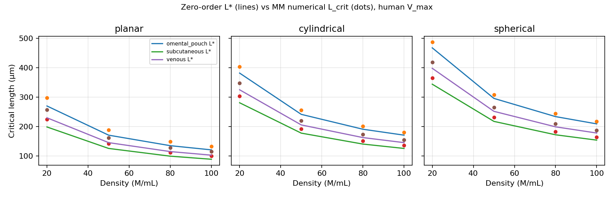

# Verified oxygen design space

**Date:** 2026-08-15  
**Claim type:** sufficient bound (zero-order Krogh) + numerical MM check  
**V_max:** 1.5e-16 mol/(cell·s) (human β-cell, conservative vs mouse 1.2e-16)  
**p_crit:** 0.5 mmHg · **D (2% alginate):** 1.5e-05 cm²/s · **S:** 1.34e-09 mol/(cm³·mmHg)

## What is proven (under model assumptions)

Steady oxygen transport with **zero-order** consumption $Q=\rho V_{\max}$ yields

$$
L^*_{\mathrm{planar}}=\sqrt{\frac{2DS(p_b-p_c)}{Q}},\quad
R^*_{\mathrm{cyl}}=\sqrt{\frac{4DS(p_b-p_c)}{Q}},\quad
R^*_{\mathrm{sph}}=\sqrt{\frac{6DS(p_b-p_c)}{Q}}.
$$

If the construct half-thickness / radius is **strictly below** $L^*$, then even if every cell consumes at $V_{\max}$, core $pO_2$ cannot reach $p_c$. Michaelis–Menten consumption is *smaller* than $V_{\max}$ at low $pO_2$, so the numerical critical length is expected to be **≥** $L^*$. That makes $0.9\,L^*$ a conservative operating certificate.

## Bound check (analytical vs BVP)

Mean $L_{\mathrm{num}}/L^*$ = **1.079** (should be ≥ 1).  
Certificate violations (certified but numerical anoxia): **0**.

### Subcutaneous planar (worst common site)

| density_million_per_ml | L_analytical_um | L_numerical_um | ratio_num_over_an |
| --- | --- | --- | --- |
| 20.0 | 198.82 | 224.86 | 1.131 |
| 50.0 | 125.75 | 142.31 | 1.132 |
| 80.0 | 99.41 | 112.22 | 1.129 |
| 100.0 | 88.92 | 100.65 | 1.132 |

### Omental spherical (best SA/V + site pO2)

| density_million_per_ml | L_analytical_um | L_numerical_um | ratio_num_over_an |
| --- | --- | --- | --- |
| 20.0 | 468.07 | 487.16 | 1.041 |
| 50.0 | 296.03 | 308.18 | 1.041 |
| 80.0 | 234.04 | 244.15 | 1.043 |
| 100.0 | 209.33 | 217.92 | 1.041 |



## Recommended operating points

Highest **oxygen-certified** loading on the discrete grid  
densities ∈ {20, 50, 80, 100} M/ml × lengths ∈ {100, 150, 200, 250} µm,  
certificate: $L \le 0.9\,L^*$ at human $V_{\max}$.

| site_key | geometry | density_million_per_ml | radius_um | L_star_um | certified_max_um | min_core_pO2_mmHg | viable_fraction_percent |
| --- | --- | --- | --- | --- | --- | --- | --- |
| omental_pouch | spherical | 80.0 | 200.0 | 234.0 | 210.6 | 15.976 | 100.0 |
| omental_pouch | cylindrical | 100.0 | 150.0 | 170.9 | 153.8 | 13.977 | 100.0 |
| venous | spherical | 100.0 | 150.0 | 178.2 | 160.4 | 12.724 | 100.0 |
| subcutaneous | spherical | 80.0 | 150.0 | 172.2 | 155.0 | 8.416 | 100.0 |
| omental_pouch | planar | 100.0 | 100.0 | 120.9 | 108.8 | 18.48 | 100.0 |
| venous | cylindrical | 100.0 | 100.0 | 145.5 | 131.0 | 21.699 | 100.0 |
| subcutaneous | cylindrical | 100.0 | 100.0 | 125.7 | 113.2 | 11.922 | 100.0 |
| venous | planar | 80.0 | 100.0 | 115.0 | 103.5 | 11.141 | 100.0 |
| subcutaneous | planar | 50.0 | 100.0 | 125.7 | 113.2 | 11.979 | 100.0 |

### Practical reading

| Use | Design | Why it is certified |
|-----|--------|---------------------|
| Conservative SQ device | planar ≤ **100 µm** at ≤ 50 M/ml, or ≤ 20 M/ml if thicker | $L^*$ SQ planar @ 50 M/ml ≈ 126 µm |
| Clinical-like loading | sphere, omentum, **150–200 µm**, 50–80 M/ml | sphere $L^*$ is $\sqrt{3}$ × planar; omentum $p_b=55$ mmHg |
| Do **not** ship | planar SQ 200–250 µm at ≥ 50 M/ml | below $L^*$, core anoxia is guaranteed at $V_{\max}$ |

IBMIR is **orthogonal** to this oxygen certificate: uncoated blood-contact sites still fail 48 h retention (~81%) in `screen_design`. Oxygen-certified portal/venous constructs still need heparin (or a non-blood site).

## What this does *not* prove

- Not a wet-lab result. Bound holds for 1D symmetry, uniform density, constant $D$, no FBR shell.
- Insulin secretion needs $pO_2 \gtrsim 5$ mmHg ($K_{M,\mathrm{ins}}$); oxygen *survival* at 0.5 mmHg is weaker than functional GSIS.
- Human $V_{\max}$ used here is stricter than the runtime default (mouse 1.2e-16).

## Reproduce

```bash
CUDA_VISIBLE_DEVICES="" python3 t1d_simulator/design_bounds.py
```
