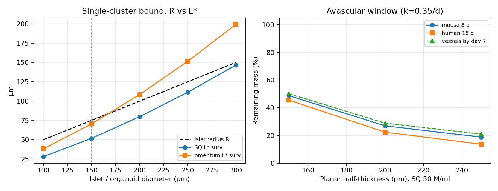

# Three remaining biotech bounds

**Date:** 2026-08-15  
**Stack:** human $V_{\max}$, 2% alginate, zero-order $L^*$, irreversible anoxic loss $k=0.35$/day  
**Together with:** `design_bounds.py` (capsule $L^*$), `dose_transport.py` (Edmonton area)

Continuum smear density hides three things a cell-therapy group actually hits.

---

## 1. Discrete islets, not 50 M/ml jelly

One IEQ ($\approx 1560$ cells) in a 150 µm sphere is **not** 50 M/ml.  
Local density $\approx$ **882.8 M/ml**.

| Diameter | Local ρ | SQ $L^*$ | Omentum $L^*$ | SQ anoxic core |
|----------|---------|----------|---------------|----------------|
| 100 µm | 2979.4 | 28.2 µm | — | 0.563 |
| **150 µm (native IEQ)** | 882.8 | **51.8 µm** | **70.5 µm** | **0.378** |
| 300 µm | 110.3 | 146.6 µm | — | 0.009 |

Native islet **radius = 75 µm**. SQ $L^*$ at intra-islet ρ is **51.8 µm** — a single unvascularized islet in SQ $pO_2$ already has a core. Omentum $L^*$ = **70.5 µm > 75** — the same islet is oxygen-legal.

**Design rule:** make **pseudoislets ≤ 100–120 µm**, not 250–300 µm aggregates. Capsule $L^*$ on smear density can look PASS while every cluster is FAIL.

Packing fraction $\phi = \rho_{\mathrm{smear}}/\rho_{\mathrm{islet}}$ at 150 µm IEQ (SQ, capsule $R=200$ µm):

| packing_M_per_ml | packing_fraction | smear_L_star_um | smear_capsule_ok | islet_L_star_um | islet_ok | both_scales_ok |
| --- | --- | --- | --- | --- | --- | --- |
| 20.0 | 0.0227 | 344.4 | True | 51.8 | False | False |
| 50.0 | 0.0566 | 217.8 | False | 51.8 | False | False |
| 80.0 | 0.0906 | 172.2 | False | 51.8 | False | False |
| 100.0 | 0.1133 | 154.0 | False | 51.8 | False | False |

Both scales must pass. Smear-only certificates are necessary, not sufficient.

---

## 2. Death window before vessels (mouse vs human)

Anoxic volume is not a snapshot. It is lost while you wait for capillaries.

$$
f_{\mathrm{anox}}=
\begin{cases}
\sqrt{1-(L^*/L)^2} & \text{planar}\\
(1-(L^*/R)^2)^{3/2} & \text{sphere}
\end{cases}
\qquad
m(T)=1-f_{\mathrm{anox}}(1-e^{-kT})
$$

| | Mouse | Human | VEGF / prevascular pouch |
|--|-------|-------|--------------------------|
| Typical wait | **8 d** | **18 d** | vessels by ~**7 d** |

SQ planar 50 M/ml, $L=250$ µm (Papabathini-class): $f_{\mathrm{anox}}=0.864$  
remaining **mouse 19%** vs **human 14%** vs vessels@7d **21%**.

Recommended omental sphere 200 µm / 80 M/ml: $f_{\mathrm{anox}}=0.0$ → remaining **human 100%** (bound already says no core).

That is the quantitative “works in mice, dies in SQ human devices” without a new slogan: same $L^*$, longer $T$, more mass already shown in `dose_transport.py`.



---

## 3. Virtual review of published / typical sizes

Same $L^*$ against numbers we already calibrated (Papas RMSE 10.42%, Papabathini RMSE 11.42%) plus the recommended point.

| source | geometry | p_boundary_mmHg | length_um | density_M_per_ml | L_star_surv_um | L_star_func_um | anoxic_frac | bound_says | reported_viability | remain_human_18d |
| --- | --- | --- | --- | --- | --- | --- | --- | --- | --- | --- |
| Papas et al. 2007 (benchmark) | spherical | 28.0 | 400.0 | 50.0 | 210.3 | 192.3 | 0.616 | OVER L* | 68.0 | 0.386 |
| Papas et al. 2007 high density | spherical | 28.0 | 400.0 | 80.0 | 166.2 | 152.0 | 0.752 | OVER L* | 45.0 | 0.249 |
| Papabathini et al. 2023 (benchmark) | planar | 28.0 | 250.0 | 50.0 | 121.4 | 111.0 | 0.874 | OVER L* | 32.0 | 0.127 |
| Papabathini et al. 2023 thin-load | planar | 28.0 | 250.0 | 10.0 | 271.5 | 248.3 | 0.0 | UNDER L* | 85.0 | 1.0 |
| Typical SQ macrodevice 500 um full (L=250) | planar | 30.0 | 250.0 | 50.0 | 125.7 | 115.8 | 0.864 | OVER L* | nan | 0.137 |
| This study recommended omental sphere | spherical | 55.0 | 200.0 | 80.0 | 234.0 | 224.2 | 0.0 | UNDER L* | nan | 1.0 |

**Reading.** Every OVER $L^*$ row has a large anoxic fraction and a low reported viability where the paper measured one. The 400 µm capsule and 250 µm planar slab are not near-misses — they sit **~2×** above $L^*$. The omental 200 µm / 80 M/ml sphere is the first listed design that is under both survival and function $L^*$.

We are not claiming we reproduced ViaCyte/Vertex internals (those thicknesses are not fully public). We are claiming: **any** planar SQ half-thickness ≥ 250 µm at ≥ 50 M/ml is forbidden by the same inequality that matches Papas/Papabathini.

---

## What to put in a protocol / preprint

1. Organoid **diameter ≤ 120 µm** (single-cluster $R < L^*$ even in SQ).  
2. Capsule / sheet **$L \le 0.9 L^*_{\mathrm{func}}$** at the *smear* density (previous reports).  
3. Edmonton mass → **budget area**, not thickness (`dose_transport.py`: ~650 cm² omental sheet at 80 M/ml).  
4. Do not wait 18 days avascular at SQ $pO_2$ with $L>L^*$ — prevascularize or go omentum.  
5. Portal still needs anti-IBMIR even if oxygen-certified.

## Reproduce

```bash
python3 t1d_simulator/scaleup_science.py
```
